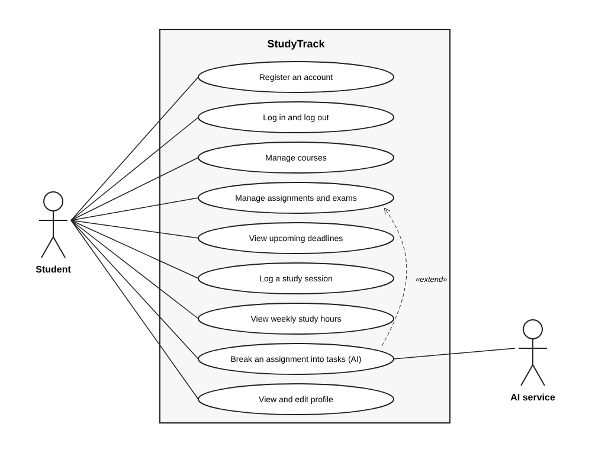
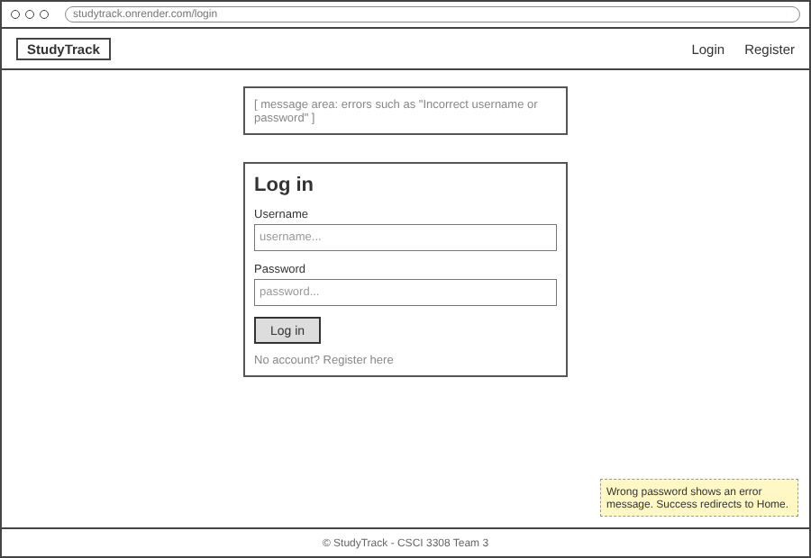
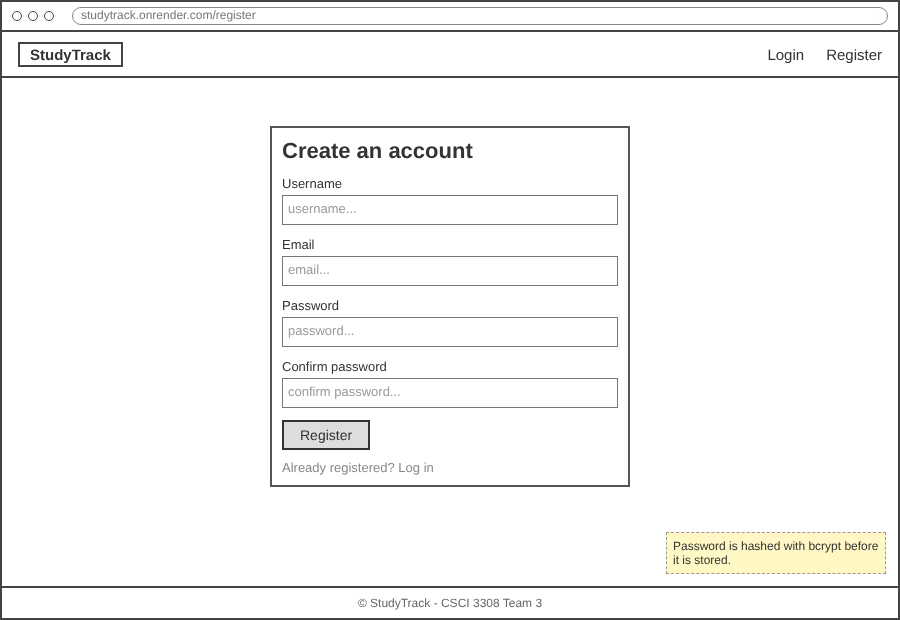
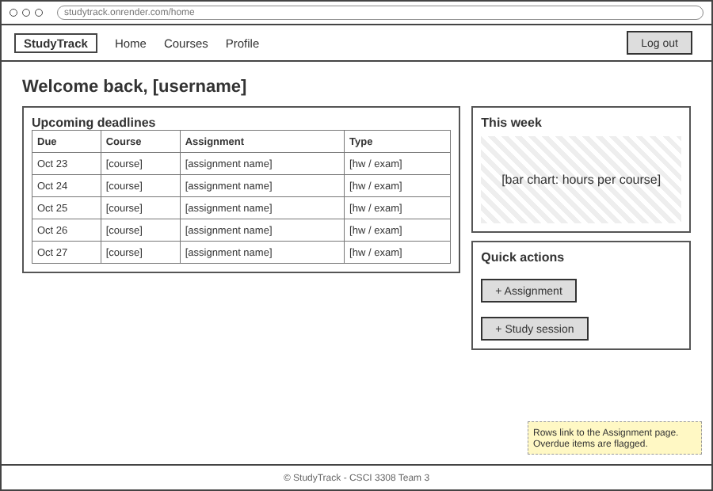
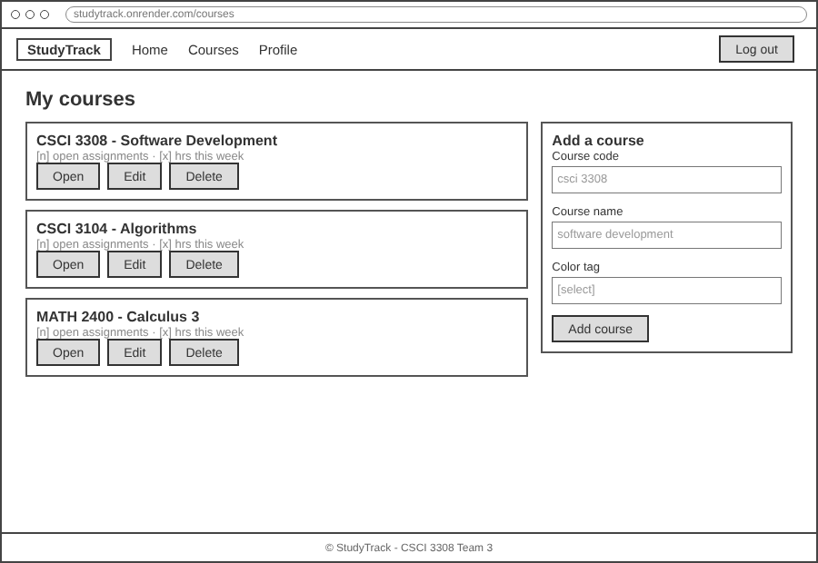
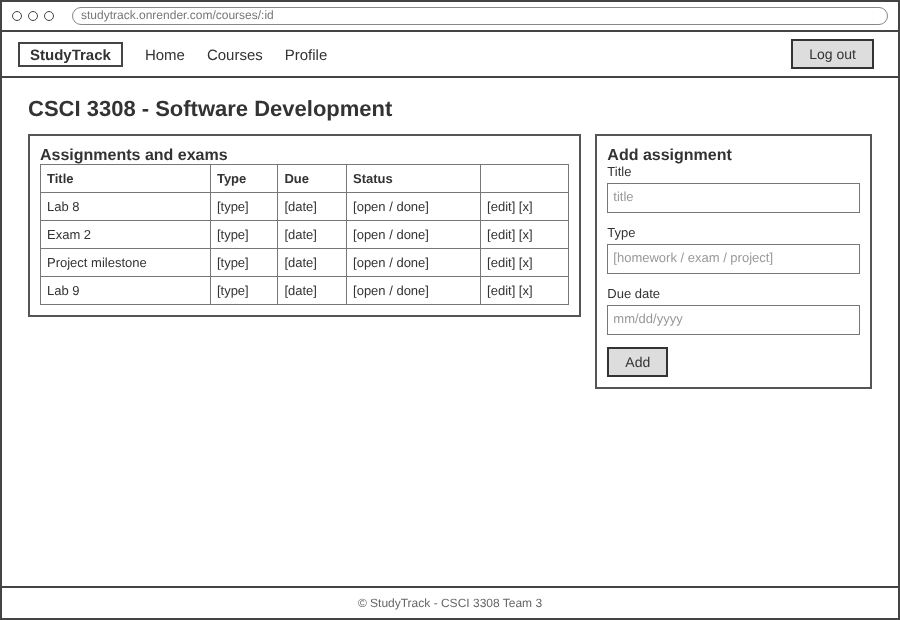
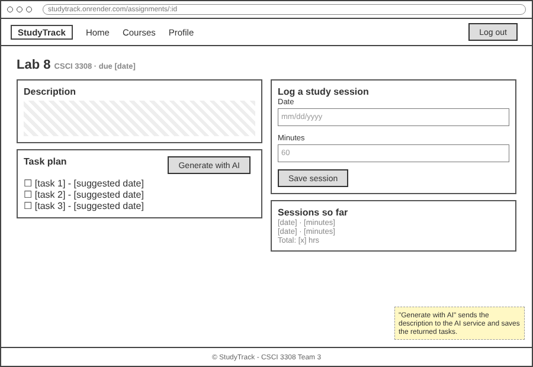
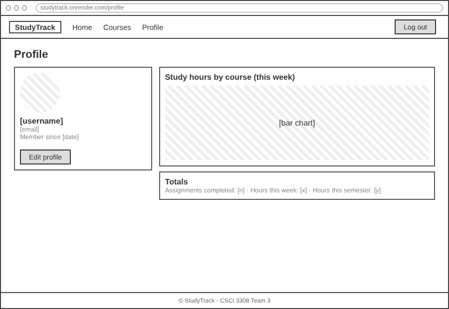
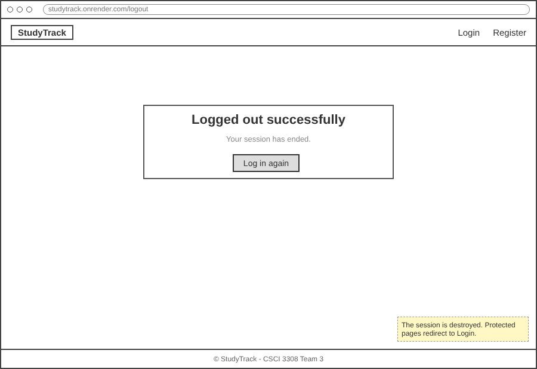

# StudyTrack: Project Proposal

**CSCI 3308, Fall 2026, Lab 8**

> Items marked **TODO** need input from the team before submission.

## 1. Team Number

013-3 (recitation section 013, team 3)

## 2. Team Name

The Enchanters

## 3. Team Members

| Name | GitHub username | Email |
|---|---|---|
| Marcus Feist | MarcusF5429 | mafe6678@colorado.edu |
| Nate Koo | nate-koo | nako2875@colorado.edu |
| Lucas Lopes | lulo2258 | lulo2258@colorado.edu |
| Nathan Novankham | nano6166 | nano6166@colorado.edu |
| Krishiv Singh | **TODO** | **TODO** |

## 4. Application Name

**StudyTrack**

## 5. Application Description

StudyTrack is a web application in which CU Boulder students keep track of their coursework and the time they spend on it. A student creates an account and adds the courses they are taking this semester. Each course holds its assignments, projects and exams, and each item has a type, a due date and a status. The home page lists the next deadlines across all courses in date order, so the student can see what is due without opening each course separately.

Students can also log study sessions against a specific assignment. A session records the date and the number of minutes spent. These records feed the profile page, which shows study hours per course for the current week and totals for the semester. A student who spends six hours on one class and one hour on another can see the gap and plan the next week with that information.

The application has one AI feature. On an assignment page, the student can press "Generate with AI", and the assignment description is sent to an AI service. The service returns a short list of smaller tasks with suggested dates, which are saved as a checklist. Large assignments are easier to start when the first step is small and clearly defined.

## 6. Audience

The ideal user is an undergraduate student at CU Boulder who takes four or five courses at once. Canvas lists due dates for each course, but it keeps no record of how long a student works on each class. Students who want that information currently have to build their own spreadsheet or Notion page. StudyTrack connects deadlines and study time in one place.

Usability and accessibility considerations:

- Every page uses the same navigation bar, with Home, Courses and Profile always one click away.
- Forms have visible labels, and errors (for example, an incorrect password) appear in a message area at the top of the page.
- Colour is never the only signal. Overdue items carry a text label as well as a colour tag.
- Pages are built with Bootstrap, so the layout works on phones, and text can be enlarged without breaking it.
- Charts on the profile page also show their values as text for screen reader users.

## 7. Vision Statement

For CU Boulder students who need to manage deadlines across several courses, StudyTrack is a study planner that links each assignment to the time spent on it. Unlike Canvas or a generic to-do app, StudyTrack shows students where their study hours go each week and breaks large assignments into small steps.

## 8. Version Control

Public GitHub repository: https://github.com/nano6166/StudyTrack

The repository root contains only the required items:

```
TeamMeetingLogs/
MilestoneSubmissions/
ProjectSourceCode/        (includes .gitignore)
ReadMe.md
```

## 9. Development Methodology

The team will follow a hybrid Agile method that uses Scrum meetings with a Kanban board. Work is planned in one-week sprints that start after each weekly TA meeting. Each user story is an issue on the public GitHub project board, which has the columns Backlog, To Do, In Progress, In Review and Done. Every user story is built on its own branch, and a second team member reviews the pull request before it is merged into `main`. 

## 10. Communication Plan

We plan to communicate about major features or changes during the recitation times in class. Outside of class, we plan to use Discord, mainly for coordinating changes to the codebase or for communicating about how to best fix merge conflicts.

Our team agreed that we will mainly keep communications during the week, but if there is something urgent we don't mind handling it over the weekend.

## 11. Meeting Plan

**Team meetings:** 

**Weekly TA meeting:** Every Monday at 6:30pm, online. A rotating scribe records decisions, the alternatives that were discussed and follow-up items with owners. The minutes are added to `TeamMeetingLogs` on the day of the meeting.

## 12. Use Case Diagram

The diagram shows nine features of StudyTrack. The student is the primary actor. The AI service is a secondary actor that is used only by the task breakdown feature, which extends "Manage assignments and exams".



## 13. Wireframes

Low-fidelity wireframes are included for each page of the application. Notes in yellow describe behaviour that a static sketch cannot show.

### Login


### Register


### Home


### Courses


### Course detail


### Assignment detail


### Profile


### Logout


## Extra Credit: Risk Analysis

**Note: this section is our submission for the Lab 8 extra credit.**

| # | Risk | Severity | Mitigation |
|---|---|---|---|
| 1 | The AI service is unavailable, slow or rate limited during the demo. | Medium | The AI feature is optional for the rest of the app. Each generated task list is saved in the database, and a timeout returns a clear message. Sample responses are stored as JSON so the demo can run offline. |
| 2 | An API key is committed to the public repository. | High | Keys are kept in `.env`, which is listed in `.gitignore`. Render receives the key as an environment variable. Reviewers check every pull request for secrets. |
| 3 | Team members edit the same files and create merge conflicts, or code on `main` breaks. | Medium | One branch is used per user story, and pull requests are small and reviewed by a second member. The team merges `main` into feature branches every day. |
| 4 | Work is spread unevenly, or one member falls behind before a weekly evaluation. | High | Stories are assigned at each TA meeting and tracked on the board. Blocked work is raised in Discord within one day, and another member pairs on it. |
| 5 | The Render deployment fails or the free database expires before grading. | Medium | Deployment is tested early (by Lab 12), and the team keeps the Docker Compose setup working locally as a fallback. The database expiry date is noted, and an SQL dump is kept in `init_data`. |
| 6 | The scope grows past what four weeks allow. | Medium | Login, registration, courses, assignments and study sessions are built first. The AI task breakdown and the charts are added only after the core features pass their tests. |
